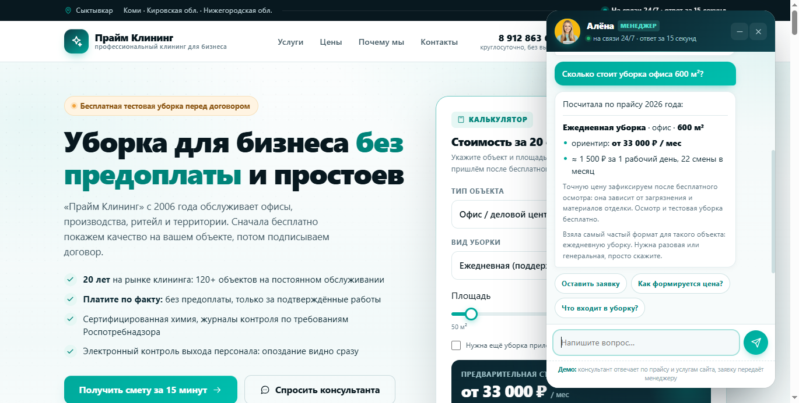
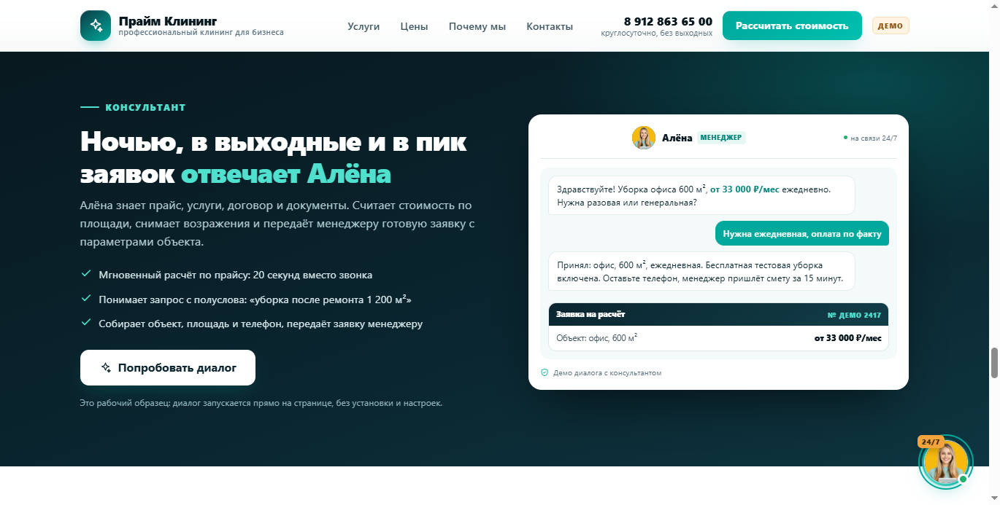
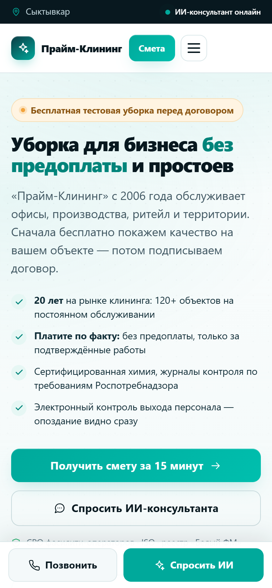

# «Прайм Клининг»: демонстрационный лендинг с консультантом

Продающая демо версия сайта клининговой компании. Сделана по информации с
[prime-cleaning.ru](http://prime-cleaning.ru/): услуги, прайс 2026, преимущества,
команда, география, порядок работы.

**Файл:** `index.html`, один самодостаточный файл. Без сборки, без CDN, без внешних картинок.
Открывается двойным кликом в любом современном браузере.

**Опубликовано:** https://yterentievsales-debug.github.io/prime-cleaning-demo/
(репозиторий: https://github.com/yterentievsales-debug/prime-cleaning-demo)

## Превью

| Главный экран | Консультант |
|---|---|
|  |  |

| Секция про консультанта | Мобильная версия |
|---|---|
|  |  |

## Что внутри

| Блок | Смысл |
|---|---|
| Шапка и микрополоса | Телефон 24/7, статус «на связи 24/7, ответ за 15 секунд», плашка «демо» |
| Hero и калькулятор | Оффер про бесплатную тестовую уборку и оплату по факту плюс расчёт за 20 секунд |
| Полоса доверия и цифры | Сегменты клиентов, 20 лет, 120+ объектов, 260 сотрудников, 3 региона |
| Услуги, 8 карточек | Ежедневная, генеральная, после ремонта, окна и фасады, дезинфекция, территория, снег и ТБО, персонал |
| Что входит в работу | Табы по типам объектов: офис, производство, ритейл, территория |
| Прайс | Таблица с ценами «от» и минимальными заказами плюс блок про тендеры |
| Почему мы | 6 причин: скорость, качество, безопасность, удобство, прозрачность, контроль |
| Сравнение | Мы против частной бригады |
| Как работаем | 5 шагов от заявки до контроля |
| Команда | 4 человека из раздела «О компании» |
| Отзывы | 3 отзыва по разным сегментам |
| Консультант | Отдельная секция: что умеет Алёна, образец диалога, фото |
| FAQ | 8 вопросов на details |
| Заявка | Форма с маской телефона и состоянием успеха |
| Контакты | Адрес, телефоны, почта, схема на SVG |
| Подвал | Меню, контакты, пометка про демо |
| Мобильная панель | «Позвонить» и «Спросить», кружок чата поверх |
| Чат консультанта | Плавающий виджет с фото Алёны |

## Консультант

На сайте нет упоминаний ИИ и AI. Чат ведёт Алёна, менеджер компании. Подача человеческая:
имя, фото, статус «на связи 24/7, ответ за 15 секунд».

Работает локально, без внешних API и ключей, по справочнику ответов.

1) **Свободный текст.** «Уборка после ремонта 1200 м2», «сколько стоит офис 600 квадратов»,
   «а снег вывозите?» Распознаются услуга, объект и площадь.
2) **Расчёт по прайсу.** Те же ставки, что в калькуляторе: ежедневная 1,7 ₽ за м² в день
   и 22 смены, генеральная 30 ₽ за м², минимальные заказы.
3) **Дозаполнение.** Если не хватает площади или формата, Алёна спросит и посчитает после ответа.
4) **Заявка.** Собирает телефон и показывает карточку с объектом, площадью и ориентиром цены.
5) **Справочник.** Около 20 тем: цены, состав работ, тестовая уборка, договор, документы,
   оплата, тендеры, гарантии, сроки, химия, регионы, контакты, вакансии.

Точки входа: плавающая кнопка на всех экранах, панель в шапке, кнопка в hero,
карточки услуг, блок FAQ, секция про консультанта, мобильная панель.

Фото: `assets/consultant.jpg`, девушка на жёлтом фоне. Кроп в круг через `object-fit: cover`
и `border-radius: 50%`.

## Правила текста

1) Нигде нет дефисов и тире: ни в заголовках, ни в кнопках, ни в прайсе, ни в чате.
   Исключение только адреса: email и домен в пометке про демо.
2) Нет слов ИИ, AI, бот, нейросеть, ассистент.
3) Телефоны пишутся через пробел: 8 912 863 65 00.
4) Диапазоны словами: «от 1 до 2 дней», «2 или 3 смены».
5) Бренд пишется с пробелом: «Прайм Клининг».

## Как адаптировать

1) **Цены.** Объект `RATES` в скрипте и таблица `table.price`. Текстовые подсказки чата лежат
   в `TYPE_RATE` и `ANSWERS`, править вместе.
2) **Тексты.** На русском, в разметке, секции подписаны комментариями.
3) **Контакты.** Телефоны, почта, адрес в шапке, контактах и подвале.
4) **Формы.** `#lead-form` и чат работают в демо режиме, никуда не отправляют.
   Для боевого запуска заменить обработчик `submit` и `completeLead()` на `fetch` к CRM.
5) **Фото.** Заменить `assets/consultant.jpg` на фото реального менеджера, пропорции 1 к 1.
6) **Аналитика.** Добавить Метрику и события: открытие чата, расчёт, отправка заявки.

## Перед публикацией реального сайта

1) Заменить демо контакты и добавить политику обработки данных.
2) Согласовать использование названия и данных с правообладателем, это макет.
3) Подключить реальные фото объектов.
4) Добавить robots.txt, sitemap.xml, микроразметку Organization, Service, FAQPage.
5) Проверить формы и чат на реальных сценариях.

## Технически

1) Один HTML файл: CSS и JS инлайн, иконки SVG спрайт, карта SVG.
2) Адаптив: 1440, 1024, 768, 500, 390 и 360 px, мобильная панель действий.
3) Доступность: Lighthouse Accessibility 100 на момент сборки.
4) Анимации отключаются при `prefers-reduced-motion`.
5) Внешних запросов нет, работает офлайн и с флешки.
