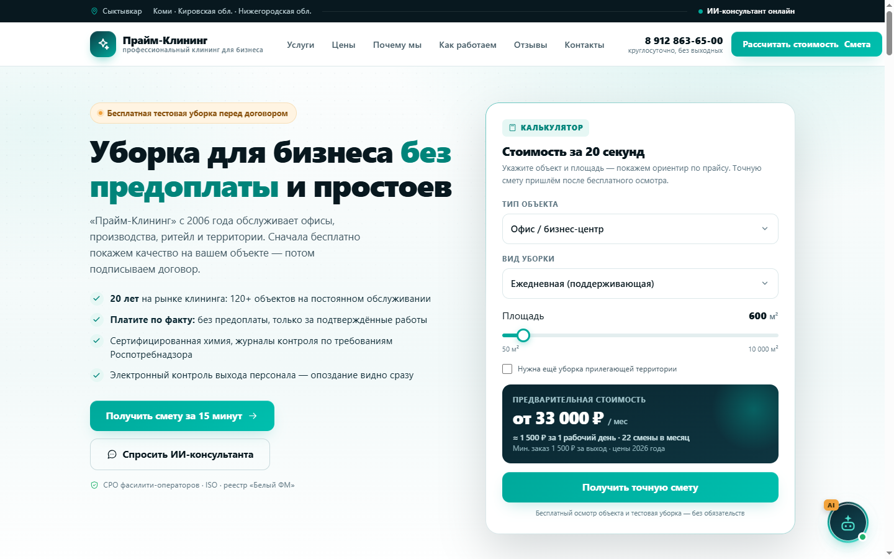
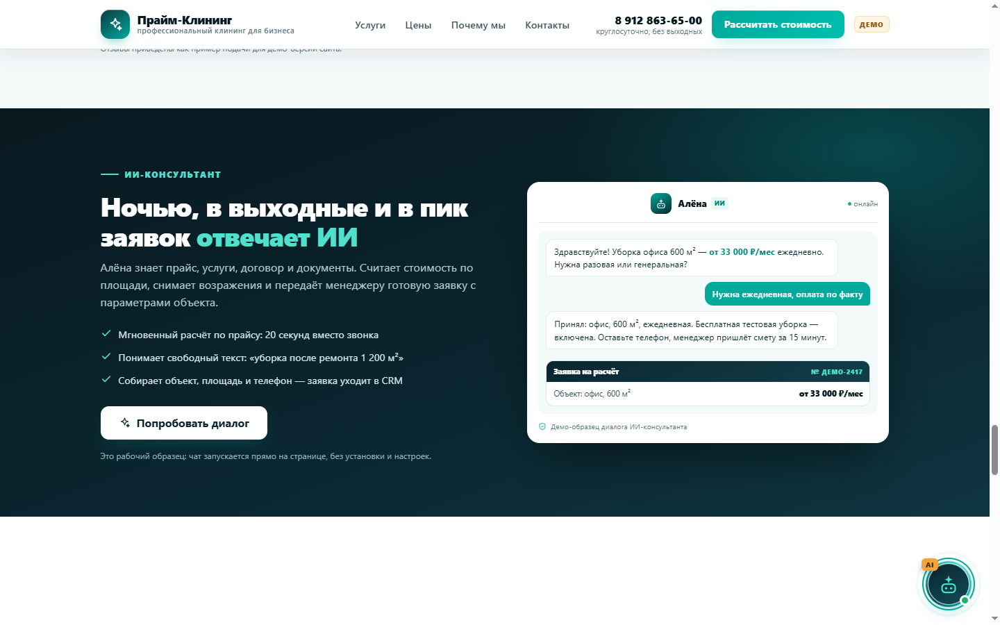

# «Прайм-Клининг» — демо-лендинг с ИИ-консультантом

Продающая демо-версия сайта клининговой компании. Сделана по информации с
[prime-cleaning.ru](http://prime-cleaning.ru/): услуги, прайс-лист 2026, преимущества,
команда, география, порядок работы.

**Файл:** `index.html` — один самодостаточный файл. Без сборки, без CDN, без внешних картинок.
Открывается двойным кликом в любом современном браузере.

## Превью

| Главный экран | ИИ-консультант |
|---|---|
|  |  |

| Секция про ИИ | Мобильная версия |
|---|---|
|  |  |

---

## Что внутри

| Блок | Смысл |
|---|---|
| Шапка + микрополоса | Телефон 24/7, плашка «демо», мобильное меню |
| Hero + калькулятор | Оффер (тестовая уборка бесплатно, оплата по факту) + расчёт стоимости за 20 секунд |
| Полоса доверия + цифры | Сегменты клиентов, 20 лет, 120+ объектов, 260 сотрудников, 3 региона |
| Услуги (8 карточек) | Ежедневная, генеральная, после ремонта, окна/фасады, дезинфекция, территория, снег и ТБО, персонал |
| «Что входит в работу» | Табы по типам объектов: офис / производство / ритейл / территория |
| Прайс | Таблица с реальными ценами «от» и минимальными заказами + блок «Пригласите на тендер» |
| Почему мы | 6 причин: скорость, качество, безопасность, удобство, прозрачность (Белый ФМ, СРО), контроль |
| Сравнение | «Прайм-Клининг» vs частная бригада |
| Как работаем | 5 шагов от заявки до контроля |
| Команда | 4 человека из раздела «О компании» |
| Отзывы | 3 отзыва по разным сегментам (пример подачи) |
| Витрина ИИ-консультанта | Отдельная секция: что умеет бот + образец диалога |
| FAQ | 8 вопросов, аккордеон на `
` |
| Заявка | Форма с маской телефона и состоянием успеха |
| Контакты | Адрес, телефоны, почта, схема проезда на SVG |
| Подвал | Меню, контакты, пометка о демо-версии |
| Мобильная панель | «Позвонить» / «Спросить ИИ» |
| ИИ-консультант | Плавающий виджет чата (главная фишка демо) |

## ИИ-консультант

Работает полностью локально, без API-ключей — на встроенной базе знаний.

- **Свободный текст.** «Уборка после ремонта 1200 м2», «сколько стоит офис 600 квадратов»,
  «а снег вывозите?» — распознаются тип услуги, объект и площадь.
- **Расчёт по прайсу.** Считает по тем же ставкам, что калькулятор (ежедневная — 1,7 ₽/м²/день × 22 смены,
  генеральная — 30 ₽/м² и т. д., с минимальными заказами).
- **Дозаполнение слотов.** Если не хватает площади или формата — спросит и посчитает после ответа.
- **Заявка.** Собирает телефон, показывает карточку заявки с объектом, площадью и ориентиром цены.
- **База знаний.** ~20 тем: цены, что входит, тестовая уборка, договор, документы, оплата,
  тендеры 44-ФЗ/223-ФЗ, гарантии, сроки, химия и Роспотребнадзор, регионы, контакты, вакансии.
- **UX.** Индикатор «печатает», быстрые ответы, сброс диалога, Esc, авто-скролл, доступность.

Точки входа: плавающая кнопка (десктоп), панель в шапке, кнопка в hero,
карточки услуг («Рассчитать»), блок FAQ, секция-витрина, мобильная панель.

## Как адаптировать

- **Цены.** Ставки — объект `RATES` в `<script>`; таблица прайса — `<table class="price">`.
  Ставки продублированы в `TYPE_RATE` (текстовые подсказки бота) — правьте вместе.
- **Тексты и оффер.** Всё на русском, лежит прямо в разметке; секции подписаны комментариями.
- **Контакты.** Телефоны, почта, адрес — в шапке, контактах и подвале (`tel:` / `mailto:`).
- **Формы.** `#lead-form` и чат сейчас работают в демо-режиме (никуда не отправляют).
  Для боевого запуска: заменить обработчик `submit` и `completeLead()` на `fetch` к CRM/webhook.
- **ИИ.** Встроенный движок можно заменить на вызов LLM API: точка входа — `route(text)`,
  ответы формируются в `botSay()`. База знаний `KB` / `ANSWERS` станет системным промптом.
- **Аналитика.** Добавить Метрику/GA4 и события на: открытие чата, расчёт, отправку заявки.

## Перед публикацией (если делать реальный сайт)

1. Заменить демо-контакты и добавить реальную политику обработки персональных данных.
2. Согласовать использование названия и данных с правообладателем — это макет.
3. Подключить реальные фото объектов (сейчас вся графика — CSS/SVG, чтобы файл оставался автономным).
4. Добавить `robots.txt`, `sitemap.xml`, микроразметку `Organization` / `Service` / `FAQPage`.
5. Проверить формы и чат на реальных сценариях, подключить уведомления менеджеру.

## Технически

- Один HTML-файл: CSS и JS инлайн, иконки — SVG-спрайт, карта — SVG.
- Адаптив: 1440 / 1024 / 768 / 500 / 360 px, мобильная панель действий.
- Доступность: Lighthouse Accessibility 100 (проверено в Chrome DevTools на snapshot).
- Анимации отключаются при `prefers-reduced-motion`.
- Внешних запросов нет — работает офлайн и с флешки.
